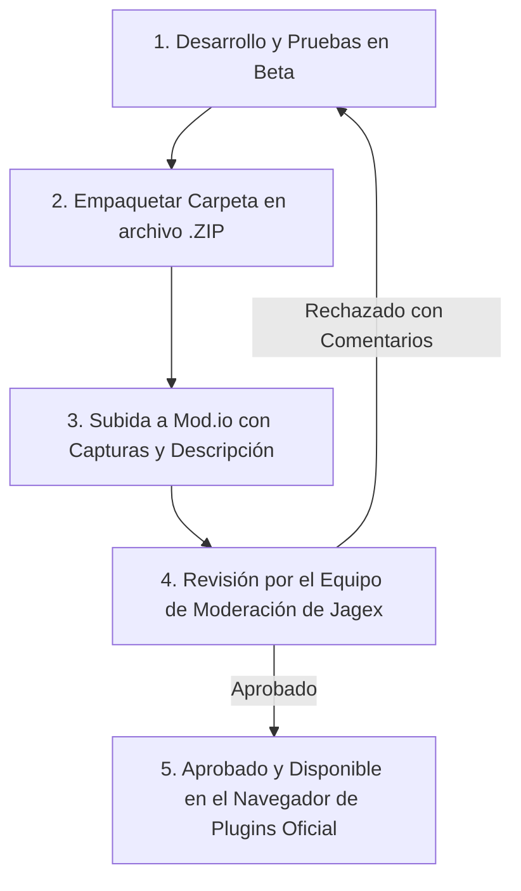

# Proceso de Publicación en Mod.io

Para que un plugin esté disponible para todos los jugadores en los mundos oficiales de RuneScape, debe ser publicado a través de la plataforma oficial **Mod.io**.

---

## Pasos para la Publicación

### 1. Preparar el Paquete (`.zip`)
* Comprime el contenido de tu plugin en un archivo `.zip`.
* Asegúrate de que `plugin.json` y `main.lua` se encuentren en la raíz del archivo comprimido.
* Verifica que la versión coincida con la declarada en `plugin.json`.

### 2. Ficha en Mod.io
En tu página de Mod.io debes incluir:
* **Nombre claro** del plugin.
* **Descripción detallada**: Qué hace el plugin, qué problema resuelve y cómo se usa.
* **Capturas de pantalla**: Imágenes claras mostrando el plugin funcionando en el juego.
* **Etiquetas (tags)**: Selecciona las categorías adecuadas (ej. Combate, Skilling, Utilidades, UI).

### 3. El Proceso de Moderación
El equipo de Jagex revisará tu plugin verificando:
1. Seguridad del código (ausencia de código malicioso o vulnerabilidades).
2. Cumplimiento de las [Directrices Oficiales](guidelines.md).
3. Estabilidad técnica (sin fugas de memoria ni caídas de fotogramas por segundo).

Si el plugin es aprobado, aparecerá en el navegador de plugins integrado en el cliente oficial de RuneScape para todos los jugadores.
