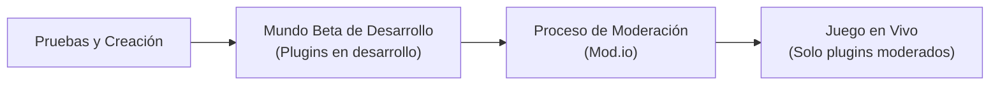

# 1. Acceso a la API (Hola Mundo)

El clásico primer paso para aprender cualquier entorno de programación es mostrar el texto **"Hello world!"**. Esto requiere preparar el entorno de ejecución, escribir el código del plugin, cargarlo en el cliente y observar el resultado.

---

## Objetivos
* Unirse al entorno beta de desarrolladores de RuneScape.
* Comprender la estructura de carpetas para plugins.
* Aprender a utilizar la consola de comandos del cliente.
* Cargar, recargar y apagar un plugin.
* Solución de problemas y lectura de errores.

---

## El Entorno de Desarrollo

Para evitar ventajas injustas en el juego en vivo, los plugins no moderados no pueden ejecutarse en los servidores normales. Jagex proporciona un **mundo beta exclusivo para desarrolladores**:



En este mundo beta, la progresión del personaje está completamente aislada de los mundos oficiales.

### Cómo Unirse a la Beta

1. **Si usas el Jagex Launcher:**
   Haz clic en este enlace para iniciar la beta directamente:  
   `jagex:launch=runescape,args=[configURI=rs-launch://www.runescape.com/jav_config_beta.ws]`
2. **Si usas el cliente directo de RuneScape:**
   Usa la URL de lanzamiento: `rs-launch://www.runescape.com/jav_config_beta.ws`

> **Importar tu Personaje**  
> Al iniciar sesión en el lobby de la beta por primera vez, pulsa el botón **"import save"** (importar partida). Esto copiará tu personaje del juego real a la beta. Puedes reimportar tu progreso una vez por hora.

### Cómo Salir de la Beta
Para volver a los mundos normales, simplemente cierra el juego y el lanzador por completo, y vuelve a iniciar RuneScape de forma habitual.

---

## Archivos del Plugin

Una vez cargada la beta, el cliente habrá creado o utilizado una carpeta raíz en tu sistema. Las ubicaciones por defecto según el sistema operativo son:

* **Windows**: `C:\ProgramData\Jagex\RuneScape-BETA`
* **macOS**: `/Users/usuario/Jagex/RuneScape-BETA`
* **Linux (Bolt)**: `/home/USER/.local/share/bolt-launcher/jagex/RuneScape-BETA`
* **Linux (Wine/Flatpak)**: `/home/USER/.var/app/com.jagex.Launcher/data/wine/drive_c/users/USER/AppData/Local/Jagex/RuneScape-BETA`

*(Sabrás que estás en la carpeta correcta si ves varios archivos con extensión `*.jcache`).*

### Crear la Carpeta de Desarrollo: `dev_plugins`

Dentro de esa carpeta raíz, crea una subcarpeta llamada:
```text
dev_plugins
```

Dentro de `dev_plugins`, cada plugin debe tener su propia carpeta (sin espacios en el nombre):
```text
C:\ProgramData\Jagex\RuneScape-BETA\dev_plugins\tutorial-plugin
```

---

## Los 2 Archivos Esenciales del Plugin

### 1. El Manifiesto: `plugin.json`
El manifiesto contiene metadatos sobre tu plugin (nombre, versión, autor). Crea un archivo llamado `plugin.json` dentro de `tutorial-plugin/`:

```json
{
    "name": "Tutorial plugin",
    "version": "0.0.1",
    "contactEmailAddress": "tu_email@ejemplo.com"
}
```

### 2. El Script: `main.lua`
Es el archivo que contiene el código Lua que se ejecutará al activar el plugin. Crea `main.lua` dentro de `tutorial-plugin/`:

```lua
print("Hello world!")
```

---

## La Consola del Cliente

Para activar y probar plugins se utiliza la consola interna del cliente.

1. Dentro del mundo beta, presiona **`ALT` + `` ` ``** (la tecla justo debajo de `Esc`).
2. Se abrirá una barra de consola en la parte superior.

### Comandos de Consola Principales

#### `plist` y `prf`
* **`plist`**: Lista todos los plugins detectados en `dev_plugins`.
  ```text
  Found 1 plugins
      tutorial-plugin
  ```
* **`prf`**: Refresca la lista de plugins del disco (útil si acabas de crear o renombrar la carpeta).

#### `pon`, `poff` y `prl`
* **`pon <nombre>`**: Enciende (activa) el plugin.
  ```text
  pon tutorial-plugin
  >> Hello world!
  ```
* **`poff <nombre>`**: Apaga (desactiva) el plugin.
* **`prl <nombre>`**: Recarga el plugin (equivale a apagar y volver a encender). **Cada vez que modifiques tu archivo `.lua`, usa `prl` para aplicar los cambios**.

---

## Solución de Problemas (Troubleshooting)

Si cometes un error de sintaxis en `main.lua`, por ejemplo olvidando cerrar unas comillas:
```lua
print("Hello world!)
```
Al intentar encender el plugin con `pon tutorial-plugin`, la consola mostrará:
```text
[ERROR] in print("Hello world!)(-1): [string "print("Hello world!)!]:1: unfinished string near <eof>
```
El mensaje de error indica:
* La línea donde ocurrió (`:1` = línea 1).
* El motivo exacto (`unfinished string near <eof>` = cadena de texto sin cerrar).

---

## Siguiente Tutorial
Continúa con la creación de ventanas y botones:  
➡️ **[2. Añadir una Interfaz de Usuario](2simpleui.md)**
