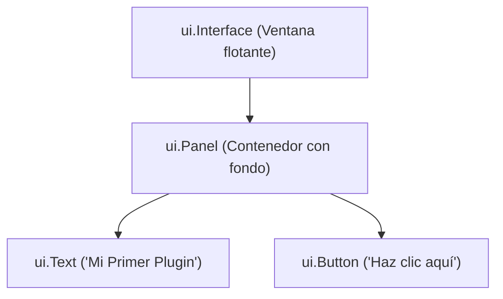

# 2. Añadir una Interfaz de Usuario

Hasta ahora el plugin solo imprime texto en la consola de desarrollo. Para que los usuarios puedan interactuar con él dentro del juego, aprenderemos a crear ventanas, paneles y botones interactivos usando el módulo `ui`.

---

## Objetivos
* Comprender la jerarquía de componentes de interfaz.
* Crear una ventana base (`ui.Interface`).
* Organizar elementos con paneles (`ui.Panel`).
* Añadir botones interactivos (`ui.Button`) y responder a clics.
* Entender las hojas de estilo (`stylesheets`).

---

## Jerarquía de Componentes

La interfaz se estructura en forma de árbol:
1. **`ui.Interface`**: Es la ventana raíz que contiene todo.
2. **Layouts (Paneles, Capas)**: Organizan el espacio y la disposición.
3. **Componentes (Botones, Textos, Sprites)**: Elementos visuales e interactivos.



---

## Creando una Ventana Simple

Modifica tu archivo `main.lua` con el siguiente código:

```lua
-- Creamos la interfaz raíz
local ventana = ui.Interface.new("TutorialUI")
ventana.title = "Mi Primer Plugin"
ventana.width = 250
ventana.height = 150

-- Creamos un panel contenedor
local panel = ui.Panel.new()
panel.width = 230
panel.height = 120
panel.x = 10
panel.y = 10

ventana:AddComponent(panel)
```

Al recargar con `prl tutorial-plugin`, verás aparecer una ventana en la pantalla del juego.

---

## Añadiendo un Botón Interactivo

Para reaccionar a las acciones del usuario, creamos un botón y conectamos una función a su evento de clic:

```lua
local boton = ui.Button.new()
boton.text = "¡Púlsame!"
boton.width = 120
boton.height = 30
boton.x = 55
boton.y = 40

-- Función callback que se ejecuta al hacer clic
boton:OnClick(function()
    print("¡El botón fue presionado con éxito!")
end)

panel:AddComponent(boton)
```

Guarda el archivo y ejecuta en la consola:
```text
prl tutorial-plugin
```
Haz clic en el botón dentro del juego y observa cómo se imprime el mensaje en la consola del cliente.

---

## Hojas de Estilo (Stylesheets)

El cliente de RuneScape incluye estilos gráficos predeterminados que emulan la apariencia oficial del juego (estilo de pergamino, bordes dorados, etc.). Puedes asignar clases de estilo a tus componentes:

```lua
panel.styleClass = "rs-panel-wood"
boton.styleClass = "rs-button-stone"
```

Consulta la guía completa de [Hojas de Estilo](../ui/stylesheets.md) para conocer todas las clases disponibles.

---

## Siguiente Tutorial
Aprende a leer datos en vivo del juego (niveles, inventario, objetos):  
➡️ **[3. Recuperar Información del Juego](3info.md)**
