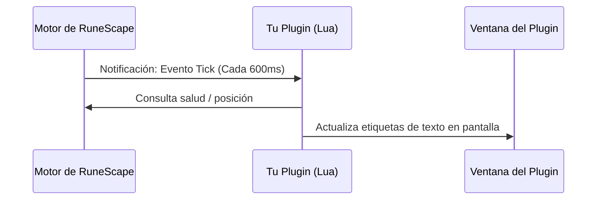

# 4. Sistema de Eventos

En el tutorial anterior leíamos la información de forma manual pulsando un botón. En este capítulo introduciremos los **eventos**, que permiten a tu plugin reaccionar de forma automática e instantánea cada vez que ocurre algo específico en el juego.

---

## Objetivos
* Comprender la arquitectura basada en eventos.
* Suscribirse a eventos del cliente (como ticks del juego o cambios en el inventario).
* Evitar sobrecargar el rendimiento del cliente.
* Manejar el ciclo de vida del plugin (limpieza al apagarse).

---

## ¿Qué es un Evento?

Un evento es una notificación enviada por el cliente de RuneScape cuando cambia el estado del juego. En lugar de verificar constantemente en un bucle infinito (polling), el cliente ejecuta tu función *únicamente cuando ocurre el hecho*.



---

## Suscribirse a un Evento

El módulo `core.Events` gestiona las suscripciones:

### 1. Evento de Tick del Jugador (`PlayerTick`)
El tick de RuneScape ocurre cada 600 milisegundos. Es ideal para monitorear estados generales:

```lua
core.Events.Subscribe(core.Events.PlayerTick, function()
    local jugador = game.Player.GetLocal()
    if jugador then
        -- Actualizamos la interfaz continuamente cada 600ms
        etiquetaSalud.text = string.format("Salud: %d / %d", jugador.currentHealth, jugador.maxHealth)
    end
end)
```

### 2. Evento de Cambio en Inventario (`InventoryUpdated`)
Se dispara únicamente cuando un objeto es añadido, removido o cambiado de casilla:

```lua
core.Events.Subscribe(core.Events.InventoryUpdated, function(invId)
    if invId == game.config.InvType.INVENTORY then
        print("¡El inventario ha cambiado!")
        actualizarListaInventario()
    end
end)
```

---

## Ciclo de Vida y Limpieza

Cuando el usuario apaga o recarga tu plugin (`poff` o `prl`), es una buena práctica cerrar ventanas y cancelar temporizadores si fuera necesario. Las suscripciones a eventos registradas por tu plugin son liberadas automáticamente por el motor al descargarse el script.

---

## Siguiente Tutorial
Haz que tu plugin recuerde datos incluso después de cerrar el juego:  
➡️ **[5. Base de Datos Persistente](5database.md)**
